# Всем привет! Меня зовут Евгений 👋  

Я являюсь специалистом по автоматизации тестирования на Java и JavaScript! А так же успешно выполняю роль TeamLead, отвечая за планирование, распределение ресурсов и соблюдение сроков на государственном проекте ГосУслуги 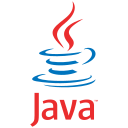</a> </a>  Мой опыт работы подтвержденный по ТК РФ — 6 лет.
 
 
> Коммерческий опыт. Проекты для которых я разрабатывал автоматизацию тестирования:
> 
 - **SBER** 
 - **Сitilink.ru** 
 - **ГосУслуги** <a href="https://www.gosuslugi.ru">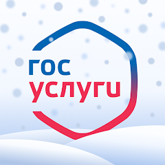</a>
 - **ОТП Банк** 

<a href="https://t.me/mihaeka" target="_blank">Я всегда на связи в Telegram</a> 

<a href="https://www.linkedin.com/in/%D0%B5%D0%B2%D0%B3%D0%B5%D0%BD%D0%B8%D0%B9-%D0%BC%D0%B8%D1%85%D0%B0%D0%B9%D0%BB%D0%BE%D0%B2-b2a2b7396/">Мой профессиональный опыт в LinkedIn</a> 

<a href="https://www.instagram.com/palm.eka">Мой блог в Instagram</a> 

  <a href="https://palmekaprocode.ru">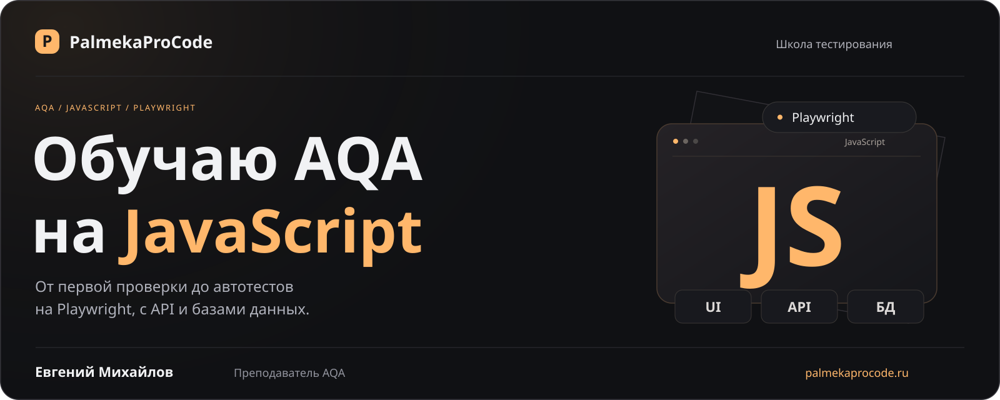</a>

<a href="https://palmekaprocode.ru/program#qa-auto-js-module-1" title="JavaScript - программа обучения"><picture><source media="(max-width: 374px)" srcset="images/school/topic-javascript-compact.svg" /><source media="(max-width: 1011px)" srcset="images/school/topic-javascript-mobile.svg" />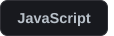</picture></a><a href="https://palmekaprocode.ru/program#qa-auto-js-module-2" title="Playwright - программа обучения"><picture><source media="(max-width: 374px)" srcset="images/school/topic-playwright-compact.svg" /><source media="(max-width: 1011px)" srcset="images/school/topic-playwright-mobile.svg" /></picture></a><a href="https://palmekaprocode.ru/program#qa-auto-js" title="UI + API - программа обучения"><picture><source media="(max-width: 374px)" srcset="images/school/topic-ui-api-compact.svg" /><source media="(max-width: 1011px)" srcset="images/school/topic-ui-api-mobile.svg" />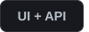</picture></a><a href="https://palmekaprocode.ru/program#qa-auto-js-module-9" title="БД - программа обучения"><picture><source media="(max-width: 374px)" srcset="images/school/topic-databases-compact.svg" /><source media="(max-width: 1011px)" srcset="images/school/topic-databases-mobile.svg" />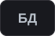</picture></a><a href="https://palmekaprocode.ru/program#program-practice" title="Практика - программа обучения"><picture><source media="(max-width: 374px)" srcset="images/school/topic-practice-compact.svg" /><source media="(max-width: 1011px)" srcset="images/school/topic-practice-mobile.svg" />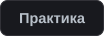</picture></a>

В моей школе PalmekaProCode разбираем JavaScript, пишем UI- и API-автотесты на Playwright, работаем с БД и закрепляем материал практикой.

Сайт школы: https://palmekaprocode.ru

<a href="https://palmekaprocode.ru/program" title="Программа и обучение"><picture><source media="(max-width: 374px)" srcset="images/school/school-program-compact.svg" /><source media="(max-width: 1011px)" srcset="images/school/school-program-mobile.svg" /><source media="(max-width: 1279px)" srcset="images/school/school-program-medium.svg" /></picture></a><a href="https://github.com/jekkka23/palmekaprocode-js-pw" title="Учебный репозиторий школы"><picture><source media="(max-width: 374px)" srcset="images/school/course-code-compact.svg" /><source media="(max-width: 1011px)" srcset="images/school/course-code-mobile.svg" /><source media="(max-width: 1279px)" srcset="images/school/course-code-medium.svg" />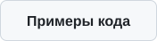</picture></a><a href="https://t.me/mihaeka" title="Связаться со мной в Telegram"><picture><source media="(max-width: 374px)" srcset="images/school/telegram-question-compact.svg" /><source media="(max-width: 1011px)" srcset="images/school/telegram-question-mobile.svg" /><source media="(max-width: 1279px)" srcset="images/school/telegram-question-medium.svg" /></picture></a>

### Посмотрите, как я объясняю

  <a href="https://www.youtube.com/watch?v=LQYv_3frQ3o">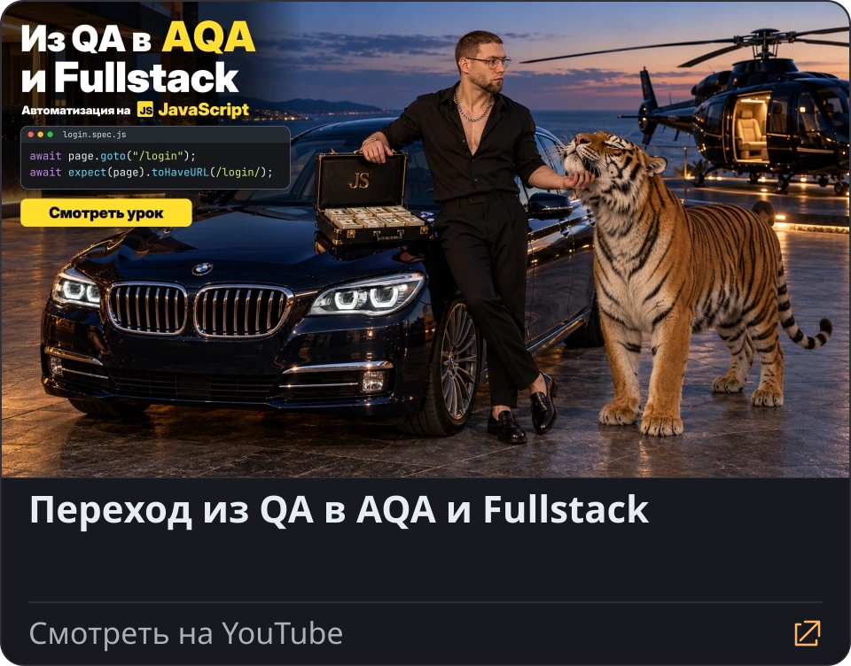</a>
  
  <a href="https://www.youtube.com/watch?v=Sam917XsiFs">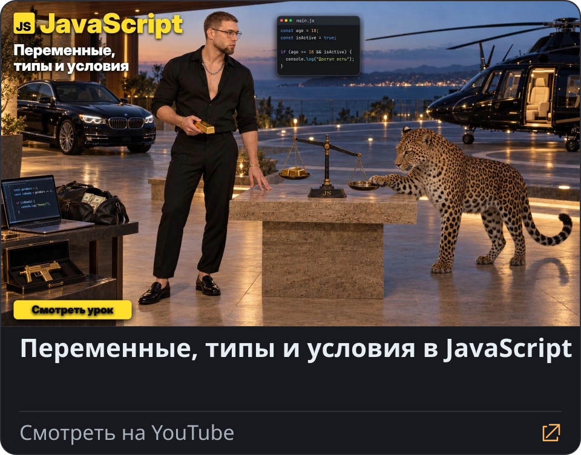</a>

  <a href="https://www.youtube.com/watch?v=Je40IPgPHSI">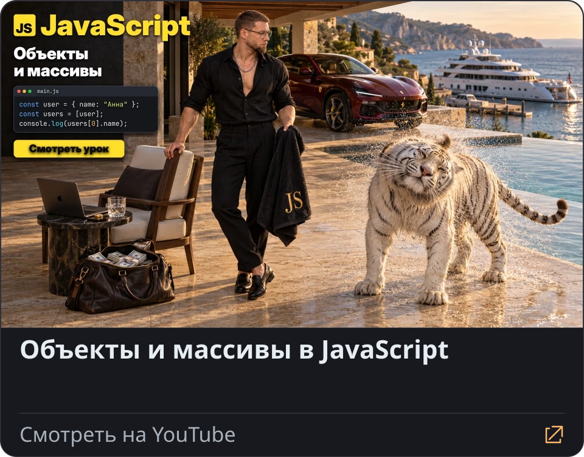</a>
  <a href="https://www.youtube.com/watch?v=hgGvcCX5sRs">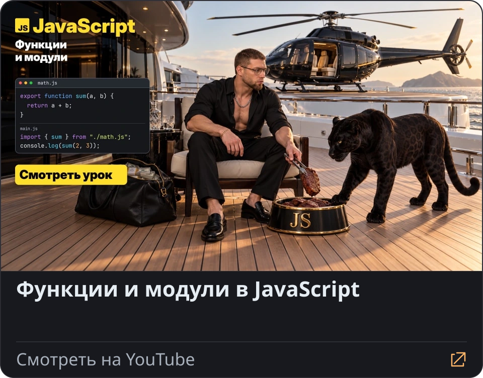</a>
  <a href="https://www.youtube.com/watch?v=K7n7gWzokoM">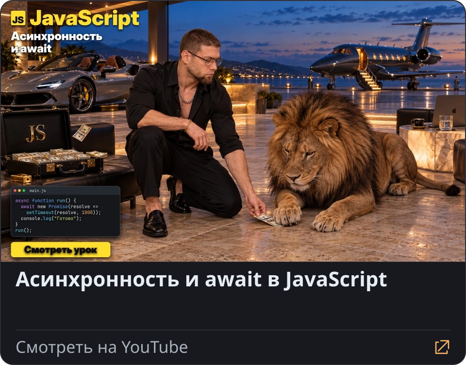</a>

  
  

## Мой стек технологий

  
  
  
  
  
  
  
  
  
 
 
 
  
<a href="https://www.atlassian.com/ru/software/jira/">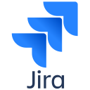</a>  
 
<a href="https://www.jetbrains.com/ru-ru/teamcity/">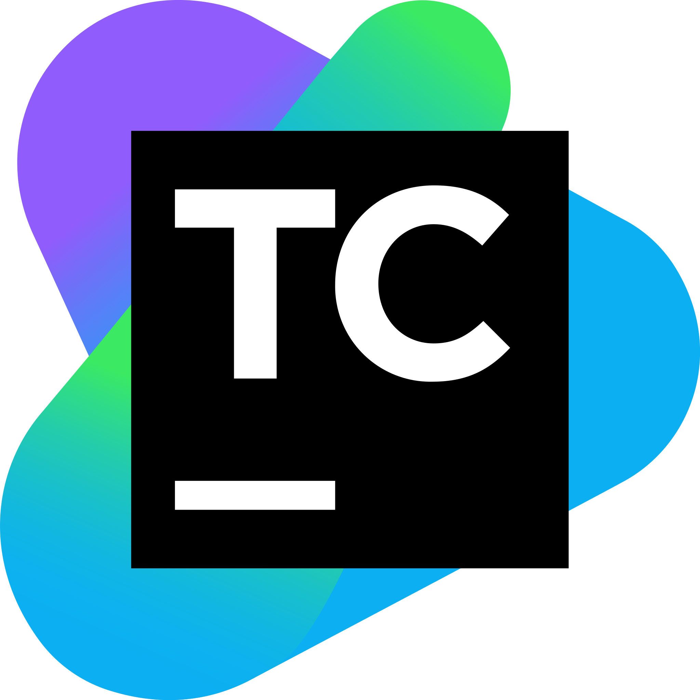</a>  
  
> - **IntelliJ IDEA**: Среда разработки для написания кода.
> - **Java**: Язык программирования проекта.
> - **JavaScript**: Язык программирования проекта.
> - **GitHub**: Платформа для хостинга и совместной разработки кода.
> - **JUnit 5**: Фреймворк для написания и выполнения тестов.
> - **Gradle**: Система сборки проектов.
> - **Selenide**: Библиотека для написания UI тестов.
> - **Selenoid**: Инструмент для управления браузерами в контейнерах.
> - **REST Assured**: Библиотека для написания API тестов.
> - **WireMock**: Заглушки HTTP для API-тестов на Java.
> - **Nock**: Заглушки HTTP для API-тестов на JavaScript.
> - **MSW**: Подмена ответов бэка в Playwright и фронтовых тестах.
> - **Axios**: HTTP-клиент для API-тестов на JavaScript.
> - **Embedded Kafka**: Брокер Kafka внутри теста на Java.
> - **KafkaJS**: Клиент Kafka для тестов на JavaScript.
> - **Testcontainers**: PostgreSQL, Kafka и WireMock в Docker на время прогона.
> - **JDBC**: Проверка данных в базе из Java-тестов.
> - **PostgreSQL**: База, с которой сверяют тесты.
> - **node-postgres**: Те же SQL-проверки на JavaScript.
> - **Allure**: Фреймворк для генерации отчетов о тестировании.
> - **Jenkins**: Инструмент для автоматизации сборки и CI/CD.
> - **TeamCity**: Инструмент для автоматизации сборки и CI/CD.
> - **Telegram**: Умею настраивать интеграцию для автоматической рассылки уведомлений о сборке проекта.
> - **Jira**: Платформа для управления проектами и отслеживания задач.
> - **Allure TestOps**: Платформа для управления тестированием и анализа результатов тестов.
> - **Playwright**: Библиотека для написания UI тестов и API.
> - **Appium**: UI-автотесты мобильных приложений Android и iOS.
## **Примеры моих работ:**

* <a href="https://github.com/jekkka23/citilink.ru" target="_blank">Проект в котором я использую весь стек технологий на Java</a>

* <a href="https://github.com/jekkka23/labirint.ru" target="_blank">UI-автотесты Лабиринта на JavaScript и Playwright</a>

* [Пример сборки в Jenkins](https://github.com/jekkka23/citilink.ru/tree/main?tab=readme-ov-file#%D1%81%D0%B1%D0%BE%D1%80%D0%BA%D0%B0-%D0%B2-jenkins)

* [Пример Allure отчетов](https://github.com/jekkka23/citilink.ru/tree/main?tab=readme-ov-file#-allure-%D0%BE%D1%82%D1%87%D0%B5%D1%82)

* [Пример уведомлений ботом в Telegram о сборке](https://github.com/jekkka23/citilink.ru/tree/main?tab=readme-ov-file#-allure-%D0%BE%D1%82%D1%87%D0%B5%D1%82)

* [Пример автоматической записи видео выполнения теста в Selenoid](https://github.com/jekkka23/citilink.ru/tree/main?tab=readme-ov-file#-allure-%D0%BE%D1%82%D1%87%D0%B5%D1%82)

